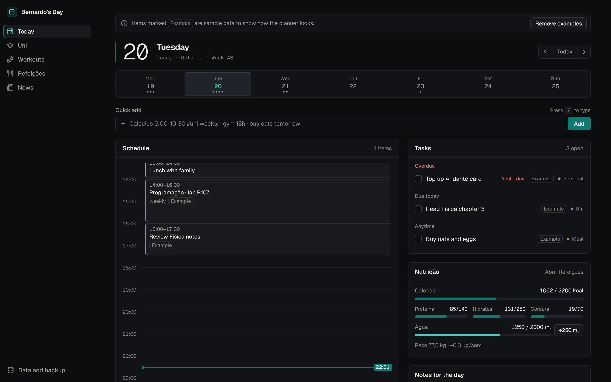
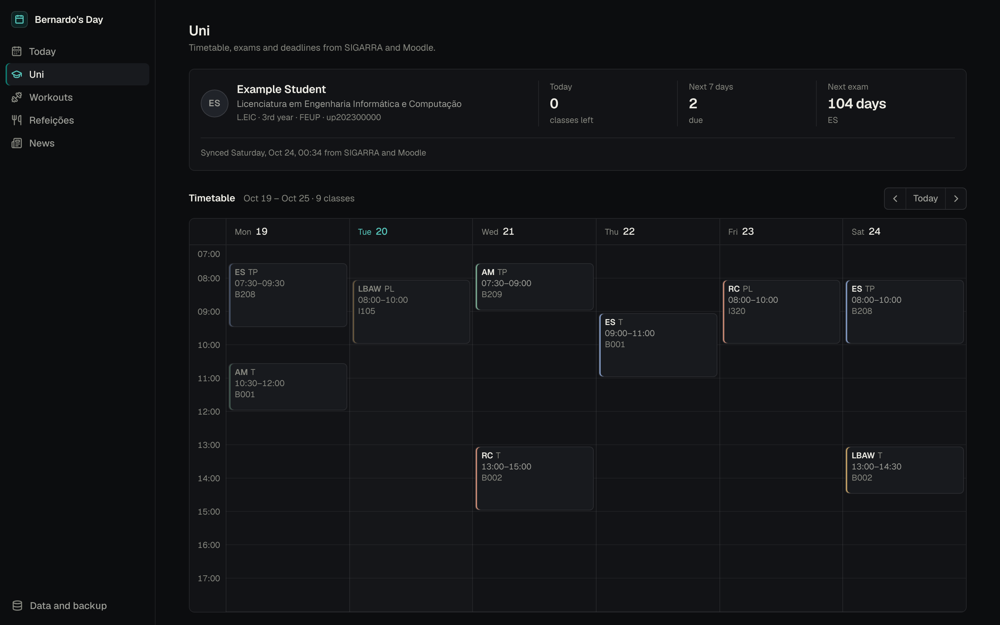
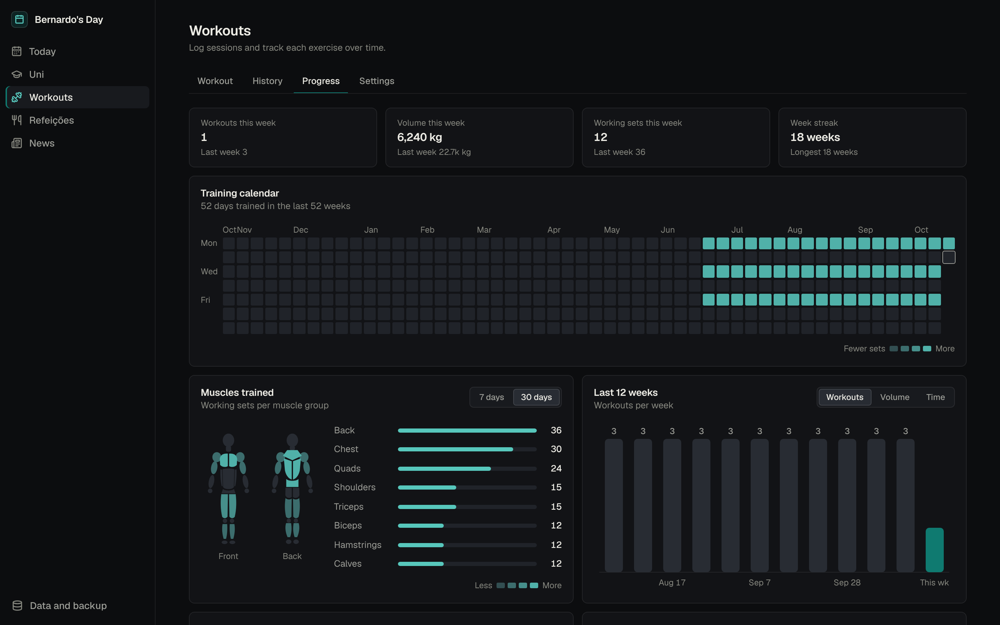
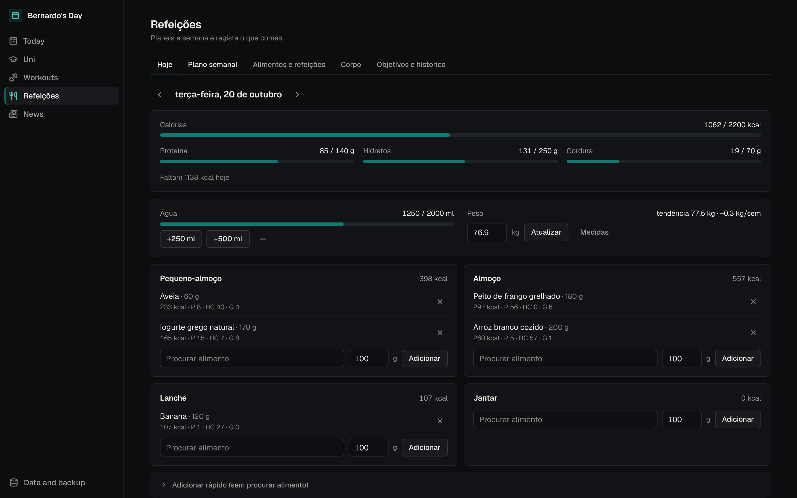
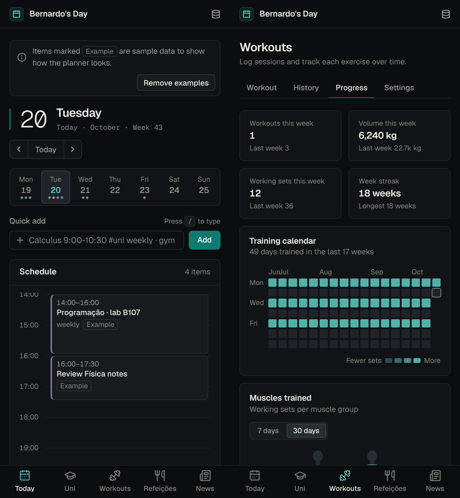

# Bernardo's Day

**A student's whole day on one screen: classes, deadlines, workouts, meals and news. Plain HTML, CSS and JavaScript, no framework, no build step.**



A personal project built around student life at FEUP (University of Porto). It started as a single `index.html` planner and grew into a modular dashboard with an optional Node server that syncs data across devices and pulls my timetable and deadlines from the university's systems.

It runs two ways:

- **Local-first:** open `index.html` (or serve the folder) and everything lives in the browser's `localStorage`. No account, no server.
- **Hosted:** a small Node server adds sign-in, a database, and server-side Moodle / SIGARRA / news sync. Deploys to Render's free plan with one Blueprint.

## Features

### Today: the daily planner
- Day view with a timeline, tasks (overdue, due today, anytime) and notes, plus a week strip.
- **Natural-language quick add** in English and Portuguese:
  `Calculus 9:00-10:30 #uni weekly` makes a weekly class, `gym 18h tomorrow` an event tomorrow at 18:00, `buy oats` a task. Tags (`#uni #gym #meal #personal`) and words like *hoje*, *amanhã*, *seg*, *às 13h* are understood.
- Each module feeds the day: classes and exams go on the schedule, Moodle deadlines become tasks, workouts show up on the days they were logged, and a nutrition card tracks calories, macros and water.
- Keyboard first: `←`/`→` change day, `t` jumps to today, `/` focuses quick add, `1`–`5` switch tabs.
- Dark and light themes that follow the system setting.

### Uni: timetable, exams and deadlines


- Weekly timetable, upcoming exams and the next 14 days of deadlines.
- Deadlines from **Moodle** through its calendar export link; timetable, exams, course units, fees and print balance from **SIGARRA**, the University of Porto's student system. SIGARRA has no public API, so the sync follows the same requests as the university's open-source student app.
- If the university's bot screen blocks the server, a **local sync tool** runs the same sign-in on your own computer and pushes the result with a revocable per-user key, so the password never leaves your machine.
- A manual timetable (CSV or typed in the app) always works as a fallback.

### Workouts: a full gym log


- Log sets as weight × reps (or distance and time for cardio) next to last session's numbers, with a rest timer and warm-up sets. A workout in progress survives a reload.
- A library of about 1,300 exercises with muscle and equipment filters and step-by-step instructions, plus ready-made templates (Push/Pull/Legs, Upper/Lower, 5×5).
- Progress: week-over-week totals, streaks, a training calendar, personal records, best set per rep range, estimated 1RM (Epley), muscle recovery and a front/back muscle map drawn in inline SVG.
- CSV import from **Strong**, **Hevy** and **FitNotes** (matched by column headers, safe to import twice) and CSV/JSON export.

### Meals: nutrition tracking (in Portuguese)


- Log food per meal from about 300 built-in foods (including Portuguese dishes), your own foods and saved recipes.
- Weekly meal plan with a generated shopping list.
- Water and body check-ins, with a smoothed weight trend (exponential moving average) so daily water swings don't hide the direction.
- A goal calculator (Mifflin-St Jeor) that switches to your **measured** energy burn once there are two weeks of logs and weigh-ins: average intake minus the energy implied by the weight trend.

### News
- World and Portuguese headlines from about 18 outlets, merged and de-duplicated from RSS 2.0, RSS 1.0 and Atom feeds by a small dependency-free parser. Feeds are configured in `modules/news/feeds.json`; broken feeds are flagged in the panel.

<sub>Screenshots use demo data: the app's built-in example items, the sample uni file and generated workout and meal logs.</sub>

### On a phone


The layout works from 375 px up, with a bottom tab bar on phones, and the app can be installed to the home screen (web app manifest).

## Tech stack

| Layer | What |
|---|---|
| Front end | Vanilla JavaScript (ES5-style IIFEs for the shell, ES modules and a Web Component for some panels), HTML, CSS custom properties. No framework, no bundler, no transpiler. |
| Design | One token file (`css/tokens.css`) for colour, type, spacing, radii and motion; self-hosted Geist and Geist Mono fonts. |
| Server | Node.js 22 (`node:http`, `node:crypto`, `node:test`, built-in `node:sqlite`), a handful of runtime dependencies: `pg` and an HTML parser (`parse5`, `css-select`, `domutils`) for SIGARRA's pages. |
| Data | `localStorage` in the browser; Postgres (e.g. Neon) or SQLite on the server. |
| Scripts | Python 3 (standard library only) for the local uni sync and the exercise-data build. |
| Hosting | Render Blueprint (`render.yaml`) or any container host (`Dockerfile`). |

## Architecture

```
            Browser (index.html)
  ┌──────────────────────────────────────────────┐
  │ Shell: store.js · core.js · app.js · tabs.js │
  │   module registry ── quick-add parser        │
  │                                              │
  │ Modules (each also runs standalone):         │
  │   uni · workouts · meals · news              │
  │                                              │
  │ localStorage  ◄── online.js (hosted only)    │
  └────────────────────────┬─────────────────────┘
                           │ JSON over HTTPS (same origin)
  ┌────────────────────────▼─────────────────────┐
  │ server/server.mjs (Node, no framework)       │
  │   auth + sessions ─ security.mjs             │
  │   synced documents ─ db.mjs ─► Postgres/SQLite│
  │   uni sync ─ uni.mjs, sigarra.mjs ─► Moodle, SIGARRA
  │   news ─ modules/news/server.mjs ─► RSS/Atom feeds
  └──────────────────────────────────────────────┘
```

- **Module registry.** `js/core.js` exposes `Dashboard.registerModule({...})`. A module can draw its panel (`render`), put items on the day's schedule (`itemsFor(date)`) and add tasks (`tasksFor(date)`). Uni, workouts, meals and news are plugged in this way, and each one also works as a standalone page.
- **Sync without a sync engine.** In hosted mode, `js/online.js` loads the user's documents before the dashboard starts, saves each change within a second and reloads when another device saved something newer. Each `localStorage` key is one versioned JSON document on the server, so the front end doesn't know whether it's online or not.
- **One data contract for uni.** The Python script and the server both write the same `uni/1` JSON format, so the panel doesn't care where the data came from.

## Engineering decisions

**No framework, no build step.** The whole front end is files the browser runs as-is. That keeps the app fast to load, easy to read and still working years from now without a toolchain upgrade. Modules talk through a small registry instead of a component framework, and styling goes through design tokens instead of a CSS library.

**Local-first.** Everything works with no server and no account; the server is an add-on. A backup can be copied as text and restored on another device, and modules provide CSV/JSON import and export.

**Security, for an app that stores university credentials:**
- Passwords are hashed with scrypt; sign-in is rate limited and takes the same time for unknown usernames.
- Sessions use random tokens in an HttpOnly, SameSite=Lax cookie (Secure on HTTPS), stored only as SHA-256 hashes. "Sign out on all devices" ends every session.
- State-changing requests must come from the same origin.
- A strict Content Security Policy (scripts only from the site itself, no CDNs, `frame-ancestors 'none'`), plus HSTS, `nosniff`, `Referrer-Policy` and `Permissions-Policy` headers.
- The Moodle link and an optionally remembered SIGARRA password are encrypted with AES-256-GCM, using a key derived (HKDF) from a secret that lives only in the host's environment, so a database copy alone reveals nothing. If SIGARRA rejects a saved password, it is deleted at once so background refreshes can never lock the account.
- The SIGARRA client only talks to `*.up.pt` hosts and refuses redirects elsewhere, so the session cookie can't leave the university. It sends an honest User-Agent and doesn't try to defeat bot protection.
- Sign-up needs a setup code, and only one account can be created unless the host allows more.

**Installable, with fallbacks.** The web app manifest and icons make it installable on a phone. Each data source degrades on its own: a failed SIGARRA or Moodle sync keeps the last good data and shows the error, a broken news feed is flagged without hiding the others, and the panels explain what to run when the data isn't there.

**Respecting licences.** The exercise dataset is MIT and its notice is kept. Some features were inspired by projects under non-commercial or AGPL licences; those were reimplemented from scratch using published formulas, and the module READMEs credit them.

**Tested where it matters.** The server has `node:test` suites for security helpers, the HTTP API, uni merging and the SIGARRA client (against a fake SIGARRA server built from the real app's requests). The Python sync has its own `unittest` suite.

## Run it locally

**Just the front end** (no install):

```bash
git clone https://github.com/BERgod27/personal-dashboard.git
cd personal-dashboard
python3 -m http.server 8000
# open http://localhost:8000
```

Opening `index.html` directly also works; the Uni and News panels need the folder served. On the Uni tab, **Show example data** loads a sample timetable. For live headlines, run `node server.mjs` in `modules/news` (see its [README](modules/news/README.md)); for your own uni data, see [modules/uni/README.md](modules/uni/README.md).

**With the server** (Node 22.13+):

```bash
cd personal-dashboard/server
npm install
APP_SECRET=$(openssl rand -base64 36) SIGNUP_CODE=pick-one npm start
# open http://localhost:8080 and create the account with your SIGNUP_CODE
```

Without `DATABASE_URL` it uses a local SQLite file.

**Tests:**

```bash
cd server && npm test                                     # Node test runner
cd modules/uni && python3 -m unittest discover -s tests   # uni sync script
```

## Deploy

- **Render + Neon (free):** `render.yaml` is a Render Blueprint for one Node web service. Create a free Postgres on Neon, choose **New → Blueprint** on Render, then paste `DATABASE_URL` and pick a `SIGNUP_CODE`; `APP_SECRET` and `CRON_SECRET` are generated for you. A health check is at `/api/health`, and an optional cron ping to `/api/cron` keeps data fresh.
- **Any container host:** the `Dockerfile` runs the same server on Node 22 Alpine with SQLite on a `/data` volume, or Postgres if `DATABASE_URL` is set.

Step-by-step instructions and every environment variable are in [server/README.md](server/README.md).

## Project layout

```
index.html, login.html   page shells
css/                     tokens.css (design tokens), app.css, online.css
fonts/                   Geist and Geist Mono (self-hosted, OFL)
js/                      store.js, core.js, app.js, tabs.js, tooltip.js
js/modules/              adapters that plug each module into the shell
js/online.js             hosted mode: sync
modules/uni/             uni panel + Python sync script (sync_uni.py)
modules/workouts/        workout tracker, exercise library, insights, CSV import/export
modules/meals/           meal planner and nutrition tracker
modules/news/            RSS/Atom parser, news helper server, <news-panel> component
server/                  Node server: auth, sync, SIGARRA/Moodle, news, tests
docs/screenshots/        images used in this README
```

Each module folder has its own README with its data format and how to mount it elsewhere.

### Adding a module

Create `js/modules/<name>.js`, add a `<script>` tag for it in `index.html` before `js/app.js`, and call `Dashboard.registerModule({...})` with `render`, `itemsFor(date)` and/or `tasksFor(date)`. Keep its data in `Store.moduleData('<name>')`. To give it a tab, add it to `VIEWS` and `ORDER` in `js/tabs.js`, to the tab bar in `index.html`, and to the view rules in `css/app.css`. The comment at the top of `js/core.js` has the details.

## Roadmap

- A service worker, so the app shell opens offline and installs as a full PWA.
- Merging edits from two devices per field instead of per document (today the first save wins and the other device reloads).
- One interface language: Meals is in Portuguese and the rest in English.
- A demo mode for the hosted version, so visitors can try it without an account.
- Continuous integration running both test suites on every push.

## License

MIT, see [LICENSE](LICENSE). Bundled third-party pieces keep their own licenses: the Geist fonts are under the SIL Open Font License (`fonts/OFL.txt`) and the exercise data in `modules/workouts/exercises.js` and `exercise-howto.js` is MIT, with its notice at the top of those files.
